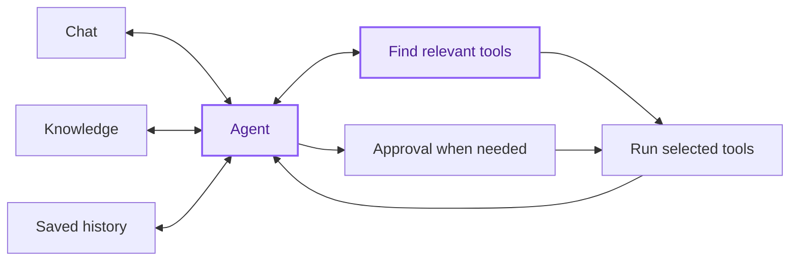
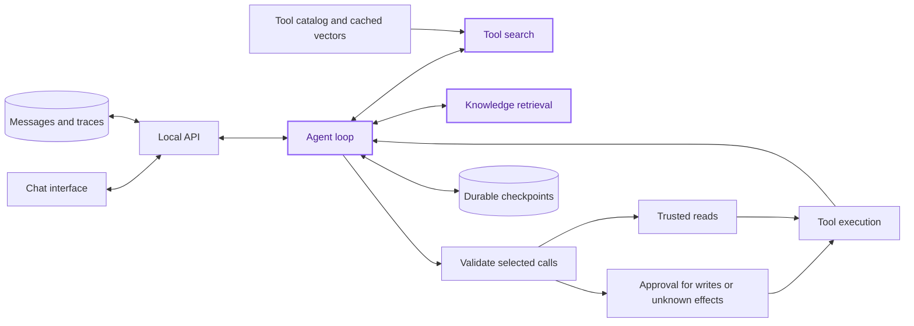

# OmniAgent - Scalable Agentic System

A local chat: discover relevant tools from a large catalog, execute a validated sequence, and explain the result. The stack is Next.js, FastAPI, LangChain/LangGraph, SQLite, and Jina embeddings.

The LLM starts with a few control tools and receives business tool schemas only after discovery. PayPal actions are **simulated**; the 72 official PayPal catalog descriptors are **metadata only**. Enabled external API/MCP connections can make real calls.

## Demo video

[▶ Watch the 60-second omniAgent demo](docs/media/omniAgent.mp4)

The silent walkthrough shows chat, tool discovery, and approvals using offline fixture data and simulated PayPal actions.

## Architecture



Purple marks the intelligent components: the agent and tool search.

“Discover tools” is `system_search(mode="capabilities", query=...)` in this implementation. It combines semantic and keyword matching and returns five candidates. Tool-description vectors are cached in SQLite; the search index is rebuilt in memory. Writes and unknown effects require approval; trusted reads do not. Document retrieval uses a separate knowledge index.

### Technical architecture and how it works



1. The Next.js interface sends a message to the FastAPI backend, which saves the conversation and streams answers, tool traces, and approval cards back through server-sent events.
2. The LangChain/LangGraph agent starts with control tools and knowledge retrieval. Tool search combines semantic and keyword matches over the catalog, then exposes only selected executable schemas to the model. Official metadata-only descriptors remain unavailable for execution.
3. The backend checks selection and arguments before execution. Trusted reads proceed directly; writes and unknown effects pause in one batch approval card per model turn. Approval authorizes the exact stored calls, and dependent calls wait for earlier results.
4. Tool results return to the agent loop to support the next step or final answer. A separate document index supplies cited knowledge. SQLite stores conversations, request status, traces, tool-description vectors, and durable execution checkpoints; the active search indexes stay in memory.
5. Compatible pending approvals and clarifications survive restart. Interrupted active calls are failed and never automatically replayed, because an external effect may already have occurred.

See the [detailed architecture and evidence](docs/scalable-agentic-system.md) for limits and trade-offs. This remains a local, single-user demo with one backend process.

## Run locally

On Windows, start the entire app with one command from the repository root:

```powershell
.\run-app.bat
```

The launcher checks for `uv` and Node.js/npm, installs missing tools through Windows Package Manager when available, installs Python **3.13**, syncs dependencies, and launches the backend and frontend in hidden windows. First-time installation needs internet access. Open [localhost:3000](http://localhost:3000) when the frontend is ready.

Click **Configure LLM** above the user profile in the sidebar. Set your chat model, endpoint, API key, and embedding settings, then save. Settings stay in `backend/.env`; saved API keys are never returned to the form. Blank API-key fields keep existing keys. Restart the backend after saving to apply changes. With no provider settings, the app still opens for setup; chat becomes available after configuration and restart.

Keep one backend process on loopback; this demo has no application authentication. To stop the app, end its uvicorn and Node.js processes in Task Manager. Stop existing servers before running the launcher again. Startup with configured providers ingests sample documents and builds indexes; provider calls can incur charges.

### Optional manual setup

You can edit `backend/.env` directly instead of using the settings form:

```dotenv
LLM_MODEL=your-tool-calling-chat-model
LLM_API_KEY=your-chat-provider-key
LLM_BASE_URL=https://your-chat-provider.example/v1
EMBEDDING_MODEL=jina-embeddings-v5-omni-small
EMBEDDING_API_KEY=your-embedding-provider-key
EMBEDDING_BASE_URL=https://api.jina.ai/v1/embeddings
# Optional: CONTEXT_BUDGET=64000
```

Chat uses an OpenAI-compatible endpoint. Embeddings use the Jina-compatible request format with 1024 dimensions. The variable names are provider-neutral; the embedding protocol has this compatibility requirement. Existing `AGENT_MODEL`, `OPENAI_*`, and `JINA_*` settings remain supported as legacy aliases.

For separate terminals, install Python **3.13**, `uv`, and Node.js/npm, then start the backend from the repository root:

```powershell
cd backend
uv sync --locked --python 3.13
uv run --python 3.13 uvicorn agent_backend.main:app --reload --host 127.0.0.1 --port 8000
```

In another terminal, from the repository root:

```powershell
cd frontend
npm install
npm run dev
```

The frontend defaults to backend port 8000; set `NEXT_PUBLIC_FASTAPI_URL` to override it. Development and builds use Webpack.

## Example prompts

- “Create and send a simulated invoice for USD 50.00 to alex@example.com.” Review the draft and send approvals separately.
- “What was my gross completed sales volume in October 2026?” The fixed demo data totals USD 150.00 and EUR 20.00 separately, after all pages.
- “Is there an open dispute from user_123?” The demo maps the user to a payer and finds D1 and D3 across pages.

Also try “How quickly does support respond?” for cited knowledge retrieval, or “What happened to my last request?” for persisted status.

## Documentation and checks

- [Project overview](docs/project-overview.md) and [shareable PDF](output/pdf/project-overview.pdf)
- [Detailed architecture, trade-offs, and evidence](docs/scalable-agentic-system.md)
- [Backend setup, API/SSE contract, and state](backend/README.md)
- [Historical verification and limitations](docs/validation.md)

Offline backend check, from `backend/`: `uv run --python 3.13 python -m unittest discover -s tests`. Frontend checks, from `frontend/`: `npm test`, `npm run lint`, and `npm run build`; `npm run check:styles` requires a running frontend. Tests use isolated stores and fake providers. Historical test results do not establish live model quality or production scale.

## SonarQube analysis

The root `sonar-project.properties` covers backend Python and frontend TypeScript sources and tests. Install or provide SonarScanner, set `SONAR_HOST_URL` and `SONAR_TOKEN` for your SonarQube instance, and run `sonar-scanner` from the repository root. Select the built-in **Sonar way comprehensive** profiles for Python and TypeScript in the server's project settings. Quality profiles and gates are managed by SonarQube, not this file.
