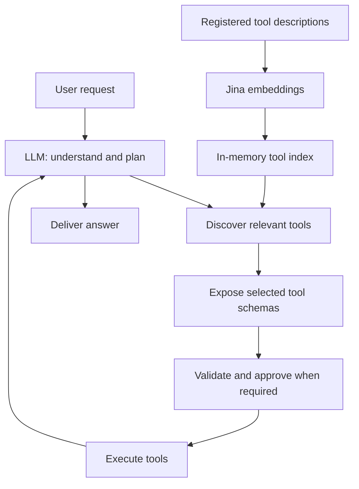

# Scalable Agentic System

A local chat demo for the Datazoic programming task: discover relevant tools from a large catalog, execute a validated sequence, and explain the result. The stack is Next.js, FastAPI, LangChain/LangGraph, SQLite, and Jina embeddings.

The LLM starts with a few control tools and receives business tool schemas only after discovery. PayPal actions are **simulated**; the 72 official PayPal catalog descriptors are **metadata only**. Enabled external API/MCP connections can make real calls.

## Architecture



“Discover tools” is `system_search(mode="capabilities", query=...)` in this implementation. It combines semantic and keyword matching and returns five candidates. Tool-description vectors are cached in SQLite; the search index is rebuilt in memory. Writes and unknown effects require approval; trusted reads do not. Document retrieval uses a separate knowledge index.

## Run locally

Requirements: Python **3.13**, `uv`, and Node.js/npm. Keep one backend process on loopback; this demo has no application authentication.

From the repository root, set up the backend:

```powershell
cd fastapi
uv sync --locked --python 3.13
```

Create `fastapi/.env` with your settings:

```dotenv
AGENT_MODEL=your-tool-calling-chat-model
OPENAI_API_KEY=your-chat-provider-key
JINA_API_KEY=your-jina-key
JINA_EMBEDDING_MODEL=jina-embeddings-v5-omni-small
JINA_BASE_URL=https://api.jina.ai/v1/embeddings
# Optional: OPENAI_BASE_URL=https://your-provider.example/v1
# Optional: CONTEXT_BUDGET=64000
```

From `fastapi/`, start the backend. Startup ingests sample documents and builds indexes; provider calls can incur charges.

```powershell
uv run --python 3.13 uvicorn agent_backend.main:app --reload --host 127.0.0.1 --port 8000
```

In another terminal, from the repository root:

```powershell
cd nextjs
npm install
npm run dev
```

Open [localhost:3000](http://localhost:3000). The frontend defaults to backend port 8000; set `NEXT_PUBLIC_FASTAPI_URL` to override it. Development and builds use Webpack.

## Try the assignment scenarios

- “Create and send a simulated invoice for USD 50.00 to alex@example.com.” Review the draft and send approvals separately.
- “What was my gross completed sales volume in October 2026?” The fixed demo data totals USD 150.00 and EUR 20.00 separately, after all pages.
- “Is there an open dispute from user_123?” The demo maps the user to a payer and finds D1 and D3 across pages.

Also try “How quickly does support respond?” for cited knowledge retrieval, or “What happened to my last request?” for persisted status.

## Documentation and checks

- [Assignment overview](docs/project-overview.md) and [shareable PDF](output/pdf/project-overview.pdf)
- [Detailed architecture, trade-offs, and evidence](docs/scalable-agentic-system.md)
- [Backend setup, API/SSE contract, and state](fastapi/README.md)
- [Historical verification and limitations](docs/validation.md)

Offline backend check, from `fastapi/`: `uv run --python 3.13 python -m unittest discover -s tests`. Frontend checks, from `nextjs/`: `npm test`, `npm run lint`, and `npm run build`; `npm run check:styles` requires a running frontend. Tests use isolated stores and fake providers. Historical test results do not establish live model quality or production scale.
