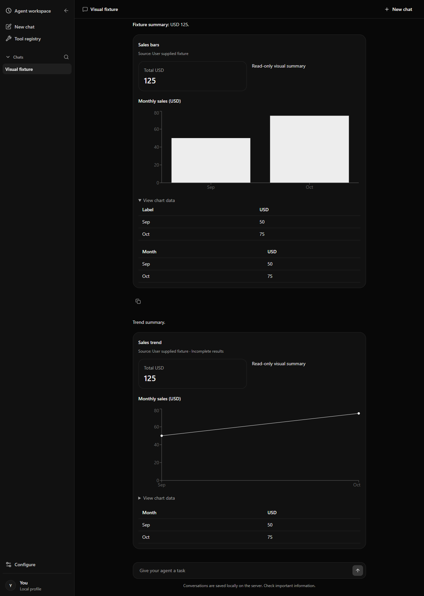
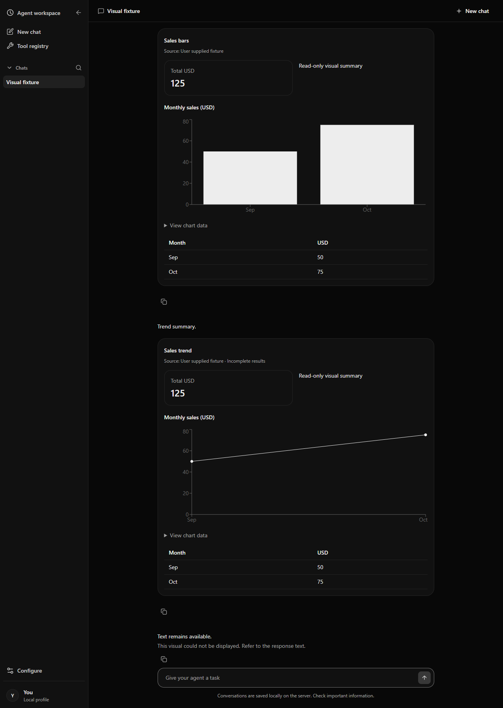
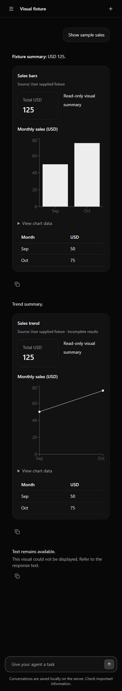

# A2UI browser evidence

Captured from the deterministic Playwright fixture with the production frontend build. The sample values are illustrative user-supplied fixture data, not business results. Desktop captures use a 1280 px viewport; mobile captures use 390 px.

## Catalog and responsive rendering

The gallery captures show the persisted conversation after reopening, with Markdown, Column and Row layouts, text, a metric card, a bar chart, a line chart, tables, chart data alternatives, source labels, and the incomplete-results label. The desktop and mobile widths are both covered.

## Invalid-surface fallback

These captures show that malformed presentation data is replaced with a local fallback while the assistant's text and other valid surfaces remain visible.

## Reproduction

From `frontend/`, run `npx playwright test tests/browser/presentation.spec.ts`. The test also checks restoration after reload, accessible chart tables, message isolation, malformed-surface handling, horizontal overflow, and browser runtime errors.
