# Application feature evidence

These browser captures use deterministic fixture data against the production frontend build. They document the main user-facing features without calling a live model, saving settings, or submitting actions. Any business values shown are illustrative.

## Workspace and conversations

The workspace home includes suggested prompts and conversation navigation. The saved-conversation capture shows a restored response with an expandable tool trace and result details.

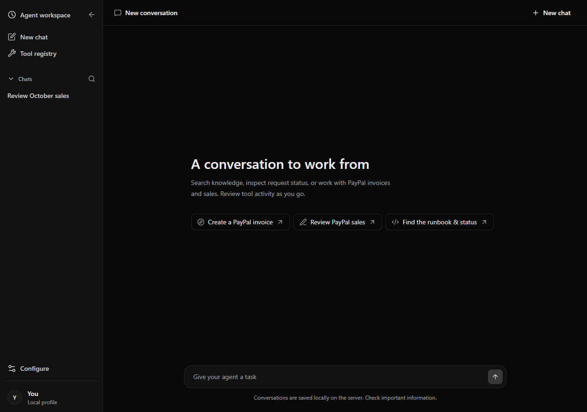

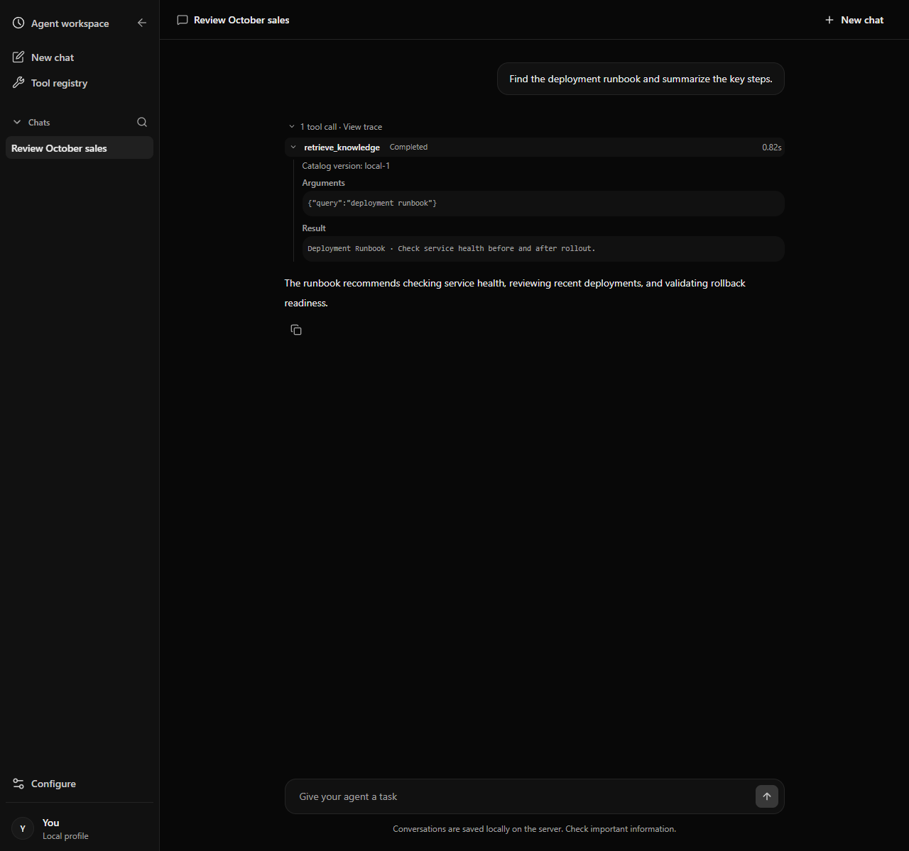

## Approval and clarification

Pending request states are restored into the conversation. The approval example shows two simulated actions awaiting separate decisions; the screenshot does not submit them. The clarification example shows a resumed question card before an answer is sent.

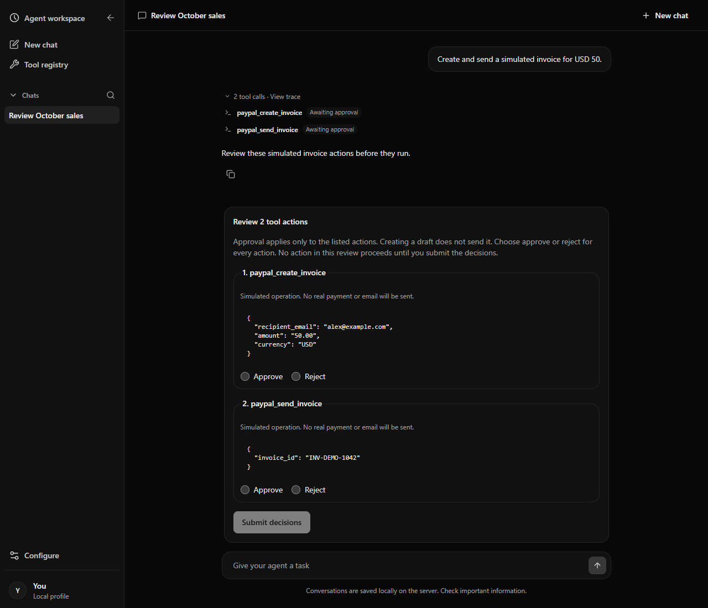

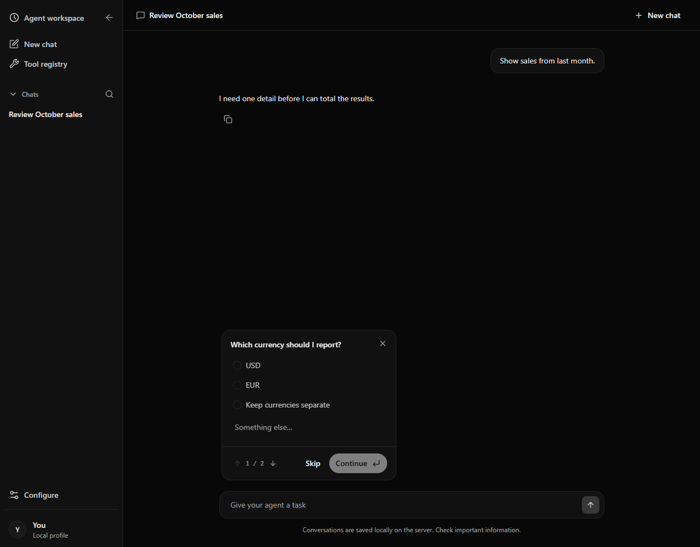

## Tool catalog and connections

The catalog includes system capabilities and business tools. Connection management shows a tested fixture connection, its enabled tool, and the local effect classification. The setup screenshot shows the fields for adding a new connection.

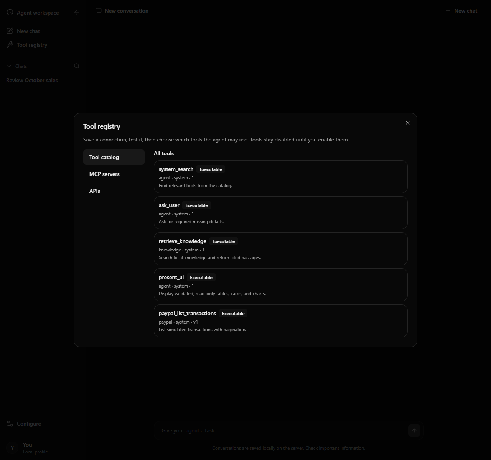

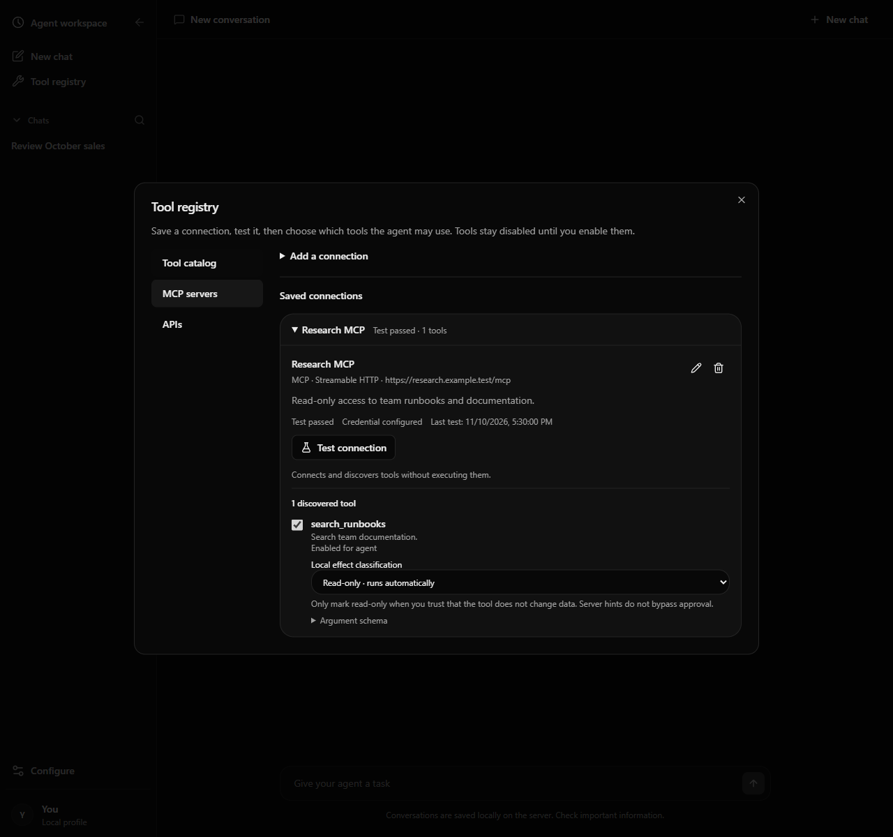

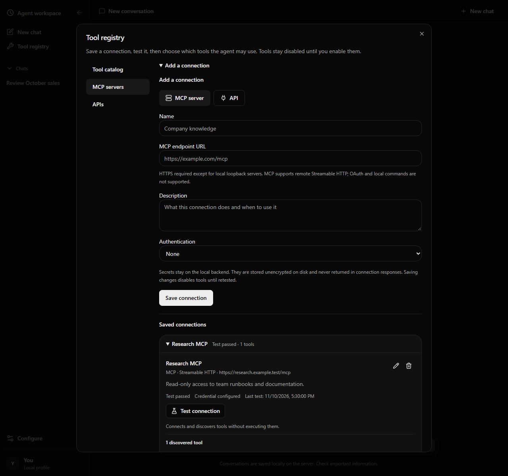

## Model configuration

This local configuration view displays model and embedding endpoints and confirms saved keys are masked. Values are fixtures; the save action was not used.

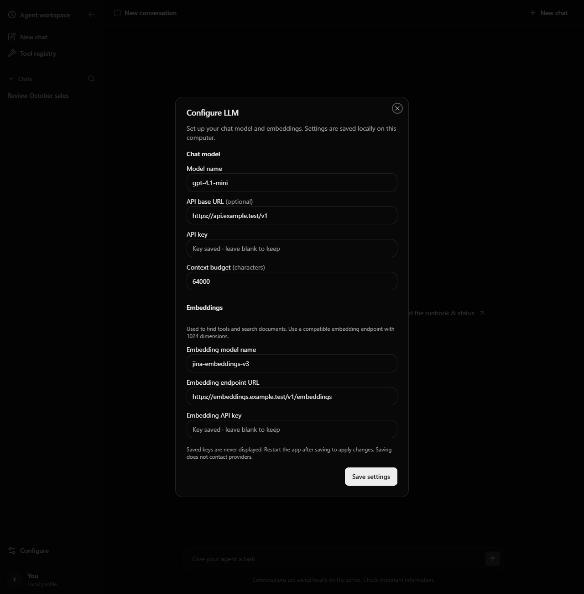

## Charts, cards, tables, and responsive layout

These saved conversation captures include Markdown, Row and Column layouts, text, metric cards, bar and line charts, tables, accessible chart-data alternatives, source labels, and incomplete-result labeling. The narrow capture uses a 390 px viewport.

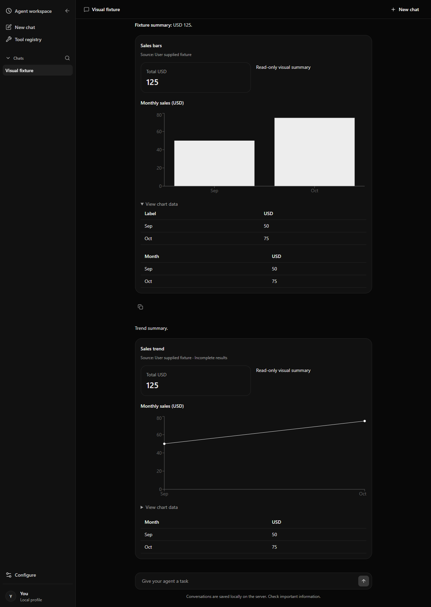

Malformed presentation data is handled locally while the surrounding text and valid visuals remain available.

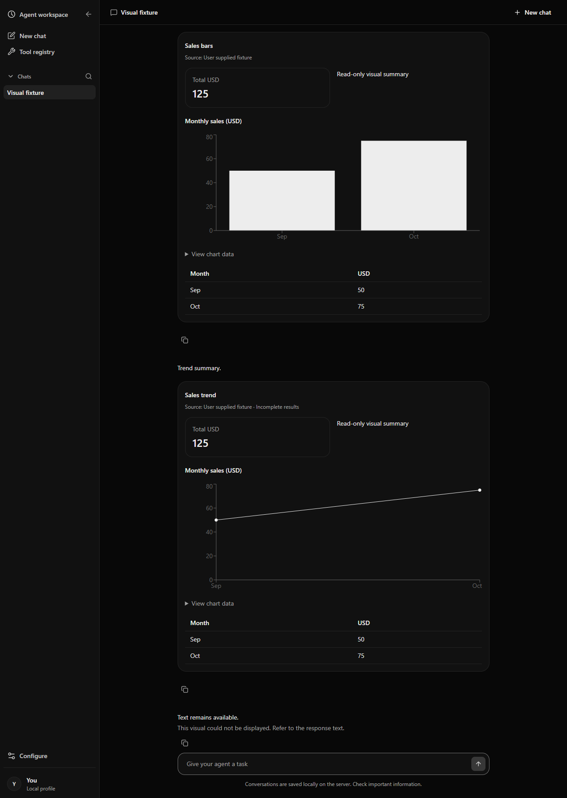

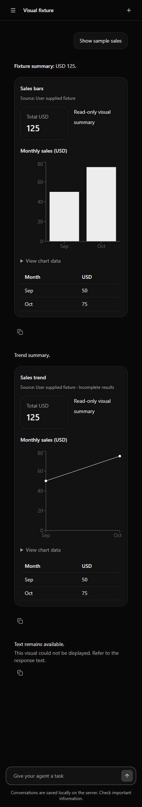

The mobile navigation is captured separately:

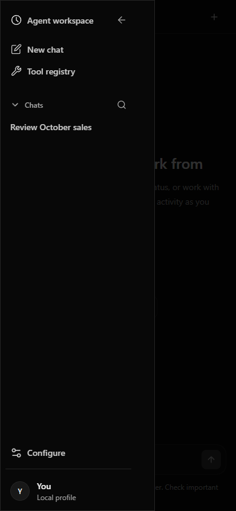

## Reproduction

From `frontend/`, run `npx playwright test tests/browser/application-evidence.spec.ts tests/browser/presentation.spec.ts`. The fixture tests exercise saved-message restoration, approval and clarification rendering, catalog and configuration screens, accessibility alternatives, malformed-data fallback, message isolation, and mobile overflow.
