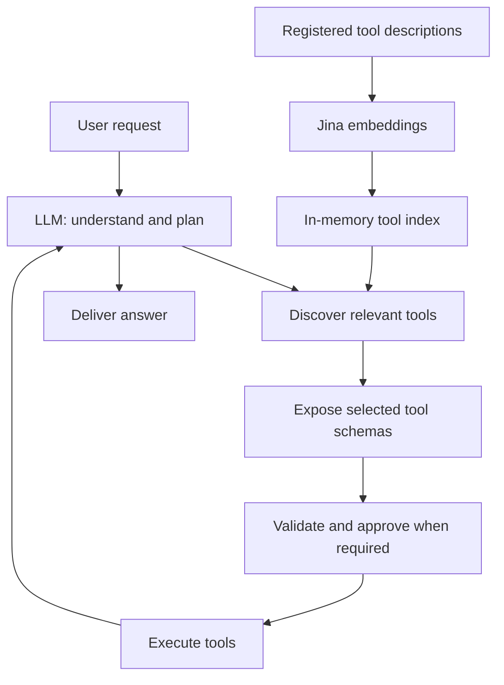

# Scalable Agentic System

Design and local demonstration for the Datazoic programming task.

## 1. Architecture and tool discovery

Giving an LLM hundreds of tool schemas increases context size and makes similar actions harder to distinguish. This design keeps a searchable catalog outside the prompt and exposes only relevant executable schemas. The agent plans inside its model loop; there is no separate planner service.

The Next.js chat sends requests to FastAPI and receives streamed answers, traces, and approval cards. LangChain/LangGraph runs the agent. Initially, the model sees `system_search`, `ask_user`, and `retrieve_knowledge`.

The conceptual `discover_tools()` operation is implemented as `system_search(mode="capabilities", query=...)`. Registered tool metadata, including descriptions and argument schemas, is embedded with Jina at 1024 dimensions. Metadata-only catalog descriptions share the tool index. SQLite caches description vectors by provider identity, dimensions, and content; startup rebuilds the in-memory index. Query vectors are not persisted.

Discovery retrieves 20 semantic neighbors, combines semantic scores with keyword overlap at equal weight, and returns five candidates. Only registered executable matches expose schemas to the model. The agent constructs arguments, passes selection/schema checks, executes eligible calls, and uses their results for the next step or final answer. Writes and unknown effects pause for approval; trusted reads proceed directly.

<!-- pagebreak -->

## 2. Assignment walkthroughs

### Send an invoice for $50

The assignment's recipient is truncated, and `$` alone does not identify a currency. The agent asks for the missing recipient email and currency rather than inventing them. For an explicit request such as “Send a simulated invoice for USD 50.00 to alex@example.com,” it discovers `paypal_create_invoice` and `paypal_send_invoice`.

The create tool validates the recipient, positive amount, and supported currency. After approval of that exact call, it creates a simulated draft and returns its invoice ID. The send step uses the returned ID and requires its own approval. The final answer reports the simulated outcome; no email or PayPal payment occurs. If sending is rejected, the answer states that the draft exists and was not sent.

### Total sales volume last month

The agent interprets “last month” as the previous calendar month in Asia/Calcutta and clarifies the metric if needed. For a request in November 2026, that interval is October 1 through November 1, exclusive of the end. The demo measures gross completed sales, filtering `status=COMPLETED` and `kind=SALE`.

It discovers `paypal_list_transactions`, follows every pagination cursor, and totals the returned amounts separately by currency. October 2026 fixtures total **USD 150.00 and EUR 20.00**. Pending sales, refunds, and fees are excluded. These figures are neither outstanding invoice balances nor currency-converted revenue. If a page fails or output is truncated, the result must be reported as incomplete.

### Open dispute from user_123

The application user ID is not a PayPal payer ID. The agent first discovers and calls `paypal_resolve_user`, which maps the demo user to `PAYER123`. It then calls `paypal_list_disputes` through all pages and filters open disputes. The demo returns **D1 and D3**; D2 is closed. An unknown mapping requires clarification, and an incomplete search cannot establish that no dispute exists.

### Separate specialist tools

- **Knowledge:** `retrieve_knowledge(query)` searches a separate knowledge index. Docling chunks local Markdown, text, and PDF documents at startup; the tool returns up to four excerpts with source/page citations where available. For “How quickly does support respond?”, the agent answers from the fictional sample policy and cites it. An empty corpus is reported as unavailable.
- **System search:** capability mode finds available operations and marks unavailable metadata. Status mode reads prior persisted requests and trace previews in the current conversation, for questions such as “What happened to my last request?” It is bounded history lookup, not arbitrary log search; its query text does not filter status history.

<!-- pagebreak -->

## 3. Scaling, state, and failures

### Scaling the catalog

The catalog can grow while each discovery still discloses five candidates. Across a request, selected executable schemas accumulate up to a limit of fifteen. This bounds tool-schema exposure rather than attaching the full catalog to every model call.

The local demo includes 72 provenance-backed official PayPal descriptors, all **nonexecutable metadata**, plus representative simulated handlers. It does not implement all 50+ real PayPal APIs. At hundreds or thousands of descriptors, the same retrieval-first interface remains useful, but the current process-local index and lexical scan still incur catalog-dependent backend cost.

For shared production use, move indexing to a shared persistent hybrid/vector store, filter tools by authenticated tenant/service permissions before ranking, and version catalogs and adapters. Separate ingestion from serving. Add worker coordination and a shared checkpoint database before supporting multiple workers. Reranking or service routing should follow measured retrieval failures rather than be assumed necessary.

### State and approvals

SQLite stores conversations, request status, traces, and LangGraph checkpoints; simulated business records have their own local database. Compatible pending approvals and clarifications survive restart. Registry changes invalidate paused approvals. Tool selections and execution budgets belong to the request; the knowledge index is rebuilt at startup.

Approvals apply to exact stored calls. Writes and unknown effects from one model turn appear in one batch card with explicit per-call decisions. Clarification answers supply missing information and never authorize effects. Independent reads may run concurrently; dependent steps consume prior results.

### Errors and bounded execution

Missing parameters trigger clarification or validation errors. Unselected, unavailable, or rejected calls are blocked. Partial workflows retain step traces so the response can distinguish a created draft from a completed send. Active interrupted calls are marked failed after restart and are not automatically replayed; uncertain external effects require reconciliation before retrying.

The default limits are three discoveries, twelve model calls, twenty tool-call attempts, and 45 active seconds, excluding approval waiting. Context is capped at 64,000 serialized characters, not tokens; tool previews are capped at 12,000 characters and mark truncation. Limits are project defaults, not assignment requirements. A failure or exhausted budget must not become a claim of full completion.

<!-- pagebreak -->

## 4. Choices, evidence, and limits

### Why these components?

- **LangChain/LangGraph:** tool schemas, a model/tool loop, durable checkpoints, and human review fit dependent workflows. A custom loop would reduce framework coupling but require implementing pause/resume consistency and failure accounting. A multi-agent runtime would add coordination overhead without solving tool selection or authorization by itself.
- **In-memory indexes with SQLite:** keep local setup small and reuse cached tool embeddings. Shared vector/database services would support durable indexes and multiple workers, at the cost of deployment and migration complexity. Checkpoints do not guarantee exactly-once external effects.
- **Hybrid retrieval:** semantic matching handles paraphrases; keyword overlap helps distinguish operation names. The current equal-weight heuristic needs representative evaluation. Jina supplies embeddings independently of the OpenAI-compatible chat provider, allowing separate model configuration and incurring separate provider costs.
- **Docling:** preserves document structure and available page citations. It adds dependency/model footprint and possible first-use downloads. Knowledge retrieval stays separate from tool discovery so document text cannot register an executable capability.

### Observability and evaluation

The application persists request status and tool traces, including call IDs, argument/result previews, duration, and catalog version. The UI streams these traces and approval decisions. They show execution activity, not private model reasoning. LangSmith or OpenTelemetry would be a future addition for distributed tracing; neither is claimed as integrated here.

Existing validation reports record offline backend, frontend, build, style, and scripted browser checks. The recorded hash-based discovery benchmark achieved 95% recall@5 on 20 labeled queries at each of 50, 100, 500, and 1,000 descriptors. This checks routing mechanics with synthetic distractors; it does not prove live semantic quality, production latency, or task completion. Historical test counts are retained in their original reports and do not validate subsequent uncommitted changes.

Live evaluation should measure retrieval recall, wrong-service selection, parameter validity, correct multi-step outcomes, false completeness, approval behavior, latency, and cost. Paid discovery/task evaluations remain opt-in and unverified. The live discovery harness still requests 1536 dimensions and needs alignment with the 1024-dimensional runtime before evaluation. No provider calls are needed for documentation verification.

### Demonstration boundary and references

This is a single-user, single-process loopback demo without application authentication. PayPal actions are simulated; enabled external API/MCP connections can make real calls. Authentication, secret management, shared indexes, distributed locks, and reconciliation of real external writes remain production work.

- [Repository README](../README.md): setup, environment variables, and demo prompts.
- [Detailed architecture](scalable-agentic-system.md): expanded workflows, trade-offs, and evidence links.
- [Backend guide](../fastapi/README.md): API/SSE contract and saved-state details.
- [Historical validation](validation.md): executed checks and limitations.
- [LangGraph persistence](https://docs.langchain.com/oss/python/langgraph/persistence) and [interrupts](https://docs.langchain.com/oss/python/langgraph/interrupts): official checkpoint/review documentation. Resume can replay node code; side effects require explicit care.
