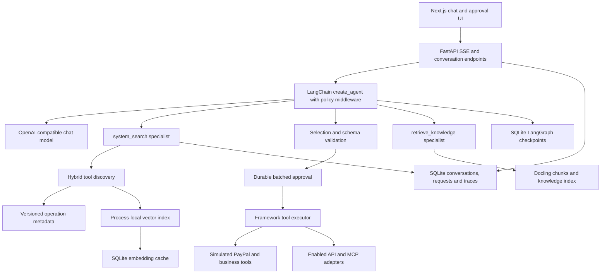
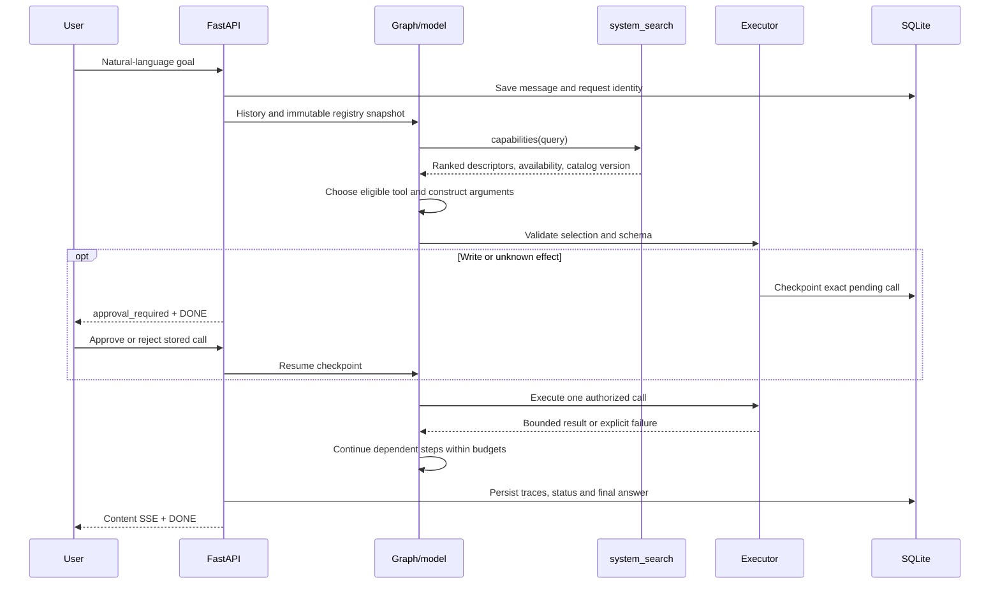

# Scalable agentic tool orchestration

## Scope and evidence

This proposal answers the supplied Scalable Agentic System epic. The epic is acceptance criteria, not runtime instructions. Its source asks for an architecture; this repository adds a runnable, local demonstration. Numeric limits and evaluation gates below are project assumptions, not assignment requirements.

The current implementation uses FastAPI, LangGraph, LangChain tool schemas, an OpenAI-compatible chat endpoint, Gemini embeddings, and a Next.js interface. It is a single-user, single-process loopback demo. PayPal records and invoice writes are **simulated**; no PayPal credentials, real invoice delivery, or payment execution are implemented. Enabled API/MCP connections can make real external calls. Writes and unknown effects require explicit per-call decisions in one batch review per model turn; trusted read classifications are approval-free.

The versioned [PayPal catalog](../fastapi/src/agent_backend/catalog/paypal-v1.json) contains 72 operation descriptors generated from six official PayPal OpenAPI specifications at revision `90e8041ffe02d80c452d2b476bedd59a8d219bdc`. Each descriptor records method, path, schema reference, upstream source, content hash, version, and `executable: false`. These are provenance-backed metadata, not 72 working integrations or complete imported argument schemas. Executable demo handlers have separate validated schemas.

Implementation evidence is linked below. The reported offline hash benchmark achieved recall@5 of 95% on 20 labeled queries at each of 50, 100, 500 and 1000 descriptors. It includes overlapping synthetic cross-service distractors. Hash embeddings measure deterministic routing plumbing and lexical overlap; these results do **not** establish real semantic retrieval quality, provider latency, or task success. Paid live evaluation has not run. Completed offline, frontend and browser verification is recorded in [validation](validation.md). Live provider behavior remains unverified.

## Components and boundaries

The model proposes calls; application code determines eligibility, validates arguments, enforces approval, and executes. Tool metadata and retrieved documents are reference data, never instructions. The knowledge index and tool index have different namespaces and responsibilities. Credentials stay in local registry configuration and are injected by adapters; they are not model arguments. No tenant authorization is implemented.

## Request lifecycle and state

[Graph state](../fastapi/src/agent_backend/agent/graph.py) stores messages, selected tool IDs, rejected signatures, framework model-call counts, discovery/execution counts, remaining active time, registry version, and failure flags. Native HumanInTheLoopMiddleware checkpoints pending batch approvals. Independent reads may execute concurrently; dependent operations wait for previous results. Selected tools are request-local; conversation text persists. SQLite checkpoints preserve compatible pending approvals and clarifications across restarts. Startup retires incompatible old-engine pauses with explicit failure, clears their pending cards, and preserves history without replaying effects. Request history is append-only, while the current-run record prevents concurrent work in one conversation. A registry change invalidates pending approvals rather than silently replacing the operation.

Current assumptions: three discovery calls, five candidates per search, at most fifteen selected tools, twelve model calls, twenty tool-call attempts, and 45 seconds of active time. Human approval waiting is excluded. The default context budget is 64,000 serialized characters including disclosed schemas, **not tokens**; oldest whole turns are removed without breaking assistant/tool pairs. A tool-result preview is capped at 12,000 characters and explicitly marks truncation/incompleteness. These bounds prevent runaway work; they also make large-page workflows stop incomplete.

## Discovery and scaling

[Discovery](../fastapi/src/agent_backend/agent/discovery.py) embeds operation descriptions and retrieves twenty semantic neighbors. It combines nonnegative semantic score and normalized lexical overlap with equal weight, sorts deterministically, and returns five descriptors including `executable`. Only registered executable candidates enter the model's selected-tool set. A metadata-only match remains visible as an unavailable capability; it cannot become executable by being mentioned in chat. The model always sees `system_search` and the knowledge specialist, plus selected schemas, rather than the entire catalog.

The [embedding cache](../fastapi/src/agent_backend/utils/embedding_cache.py) keys description vectors by endpoint/model identity, dimension, and content. Restart rebuilds the in-memory index using cached vectors; changed descriptions embed again. Query vectors are not persisted. Changing embedding identity or dimensions creates distinct cache keys. The catalog version is attached to discovery/traces. Enabled registry updates publish immutable agent snapshots and retain the previous snapshot if rebuilding fails.

| Catalog size | Current demonstration | Proposed growth step |
| --- | --- | --- |
| 50+ | 72 official operation descriptors plus executable local tools; five candidates disclosed | Curate operation descriptions and distinguish draft/send and read/write |
| 100+ | Same bounded disclosure; offline 100-descriptor smoke case | Evaluate ambiguous service names and unavailable capabilities |
| 500 | Same model schema budget; offline 500-descriptor smoke case | Filter by authorized tenant/service before retrieval; measure real provider recall and p95 latency |
| 1000+ | Offline 1000-descriptor smoke case; in-memory search and lexical ranking still scan catalog data | Use persistent vector/hybrid indexes, metadata filters, batch ingestion and service-level routing when measured cost justifies them |

Constant model disclosure does not mean constant backend cost. Current startup builds the full index, cache misses embed in batches, and lexical ranking scans all descriptions. The index is process-local. Thousands of tools across many tenants require versioned shared indexes and authorization filters; the present benchmark does not prove production capacity.

When candidates overlap, the response asks which service or account the user intends rather than assuming. Production routing should filter by permissions, service, environment and schema version before ranking, then use curated examples/reranking where measured recall requires it. Low confidence should trigger clarification or a narrower search. The current demo instructs clarification but has no calibrated confidence threshold or independently verified semantic classifier.

## PayPal-style workflows

### Send an invoice for $50

The original assignment truncates the recipient. Ask for the recipient email and explicit currency; `$` does not uniquely identify a currency. Do not invent merchant, recipient, currency or delivery details. Once supplied, discover both `paypal_create_invoice` and `paypal_send_invoice`. Validate email, positive Decimal amount with two decimal places, and supported currency. The current simulated flow is:

1. Present an approval for creating the exact draft: recipient, `50.00`, currency. Rejecting prevents that identical call during the run.
2. On approval, create a durable simulated draft with an invoice ID. A trusted request scope and normalized payload form the local idempotency key.
3. Pass the returned ID to the send tool only after successful creation. Present a separate send approval.
4. Report `SENT_SIMULATED` and the ID; explicitly state no real email or PayPal call occurred. If send is rejected or fails, report that the draft exists and delivery did not complete.

Repeated local create calls in the same request scope reuse the draft; repeated simulated sends are idempotent. These guarantees do not transfer to an actual PayPal adapter. A real adapter must resolve its full required schema, acquire merchant OAuth outside the model, use supported request-id/idempotency semantics, persist step receipts, and reconcile uncertain responses before any retry.

### Total sales volume last month

Resolve last month as the previous calendar month in Asia/Calcutta. With the evaluation clock fixed at November 11, 2026, the interval is `[2026-10-01, 2026-11-01)`. Clarify the business definition where needed. The demo defines **gross completed sales**: include only `status=COMPLETED` and `kind=SALE`; exclude pending transactions, refunds and fees. This is not net revenue, outstanding invoices or converted settlement volume.

Call `paypal_list_transactions` for every `next_page` until null, then add Decimal amounts separately by currency. October fixtures produce **USD 150.00 and EUR 20.00**. Never combine currencies without an explicit FX source, date and conversion policy. A page failure or truncated result prevents a complete-total claim. For real reporting, account for API date-window limits, duplicate IDs, timezone boundaries and late status updates; use deterministic server-side aggregation for large datasets rather than asking a model to add thousands of rows. The separate legacy outstanding-invoice tool computes USD 125.50 and EUR 20.00; that is a different metric.

### Is a dispute open from user_123?

`user_123` belongs to the merchant application, not the PayPal identity namespace. First call `paypal_resolve_user`; the local merchant directory returns `PAYER123`. An unknown or ambiguous mapping requires clarification and must not become a fabricated payer ID. Then call `paypal_list_disputes(payer_id, page)` until no next page remains. Filter `OPEN`: the fixtures contain D1 and D3, with D2 closed. The second page matters. Report those open IDs; an empty complete result means no matching open dispute in the queried scope, not proof that no dispute exists anywhere. A production integration must map documented provider identity/status fields and scopes rather than assume the simplified fixture shape.

## Separate specialist tools

`retrieve_knowledge(query)` answers documentation questions. Startup ingests local `.md`, `.txt` and `.pdf` documents using Docling structural chunks into the `knowledge` namespace. Gemini embeds document text and queries. For “How quickly does support respond?”, retrieve at most four excerpts, return source/page citations where available, and base the answer on those excerpts. Missing knowledge produces an explicit unavailable result. Retrieval relevance is not proof of factual support: the model must cite supporting text and acknowledge gaps. The sample policies are fictional. No upload endpoint, scheduled refresh, durable knowledge index or document-level access control is implemented.

`system_search` is a distinct introspection tool with two modes:

- `{"mode":"capabilities","query":"PayPal create and send invoice"}` returns ranked capabilities, executable availability and catalog version. Official metadata can explain a missing integration without enabling it.
- `{"mode":"status","query":"What happened to my last request?"}` reads persisted request/tool status in the current conversation. It exposes at most five previous requests and twenty trace previews per request; the current request is excluded. It can explain a prior rejected send or failed step after later turns/restart. The current implementation does not perform arbitrary log search or filter by `query` in status mode.

Status lookup does not consume a discovery slot. `system_search` must be called alone. These specialists separate documentation, capability metadata and execution evidence so that one retrieval corpus cannot be mistaken for another.

## Failure and recovery

| Failure | Current behavior | Production extension |
| --- | --- | --- |
| Missing/invalid arguments | Ask for missing fields; validate schema before execution; return bounded error | Domain validation against account/environment and provider schema |
| Unknown or unavailable tool | Reject unselected/nonregistered names | Authorization-filtered registry and signed/versioned adapters |
| Discovery/provider failure | Explicit failure or bounded retry opportunity; no fabricated success | Circuit breakers, rate limits and provider health metrics |
| Rejected approval | Exact stored operation blocked for run | Authenticated approver identity and policy audit |
| Registry changed while paused | Resume fails; user starts a new request | Version-pinned deployment and migration policy |
| Partial multi-step completion | Preserve traces; report completed steps and remaining failure | Durable workflow ledger and explicit compensations |
| Crash during active execution | Mark running requests/traces failed at startup; no automatic replay | Reconcile uncertain external effects by provider receipt/idempotency key |
| Timeout or exhausted budgets | Return incomplete result and terminal budget status | Async jobs for long workflows with bounded worker leases |
| Oversized context/output | Remove whole old turns or mark result incomplete | Token-aware budgets and deterministic paged aggregation |

There is no exactly-once guarantee across an external request and local checkpoint commit. Checkpoints preserve orchestration state, not an atomic transaction spanning PayPal and SQLite. Never retry a consequential action merely because its response was lost.

## Technology decisions and alternatives

LangGraph provides explicit transitions, resumable interrupts and SQLite checkpoints. LangChain supplies tool-schema/model adapters and ToolNode execution. This fits a visible, inspectable workflow better than an unbounded autonomous loop. The costs are dependency/version complexity, framework-specific message state, and careful coordination of checkpoints, application records and external side effects.

A custom Python loop is a plausible simpler alternative for discovery → validated call → response. It reduces framework coupling, but would require implementing durable interrupts, resume validation, message/call consistency and failure accounting. It becomes attractive if the graph remains small and maintaining those mechanisms costs less than adapting LangGraph. CrewAI-style multi-agent delegation adds coordination and token overhead without resolving catalog authorization or schema correctness by itself; it is unnecessary for this demo.

An in-memory vector store with a SQLite embedding cache keeps local setup small and permits isolated tests. A persistent vector database or PostgreSQL/pgvector would add durable shared indexing, metadata filtering and worker reuse, at the cost of deployment, migration and index-version management. Adopt it based on measured catalog/tenant size and latency, not a presumption that 100 tools require a new service. Pure lexical search avoids embedding cost but misses paraphrases; pure semantic search can confuse similar business actions. The hybrid is an initial heuristic requiring representative evaluation.

Docling preserves document structure and available page citations, but adds local model/dependency footprint and possible first-use asset downloads. Hosted retrieval reduces that runtime footprint while introducing provider data handling/cost and access-control decisions. Gemini embeddings and the chat provider are independently configured; their availability, cost and data policies are deployment decisions, not assignment mandates.

## Observability and quality

Persist request identities, statuses, call IDs, tool IDs, arguments/result previews, durations and catalog versions. SSE traces update the UI by stable trace ID across approval/resume. Application logs record node timing and outcome categories without raw records or credentials. Trace redaction covers common secret syntax and credential-like fields; it is not a personal-data scrubber. Local checkpoints, traces and registry files contain sensitive state and need OS access protection.

LangSmith or equivalent OpenTelemetry tracing can add distributed spans for discovery, model, approval and execution in production. Do not export raw business text or credentials by default. Measure candidate recall@5, wrong-service selection, parameter validity, unavailable-tool execution attempts, end-to-end task correctness, false completeness, approval/restart behavior, cache misses, query/index latency, model usage and cost. Use held-out paraphrases, real catalog overlaps, negative/ambiguous queries, adversarial retrieved text and provider failures. Report per-service and per-size results, not just an average.

The 95% retrieval target is a project assumption. The evaluation harness defaults to offline discovery smoke tests; `--mode discovery` opts into paid Gemini retrieval evaluation and `--mode tasks` opts into ten live workflow checks with programmatic answer and trace assertions. All task checks must pass. Neither paid mode has run. Scripted models verify execution/state mechanics, not live model reasoning. See [measured offline results](evaluation-results.json) and [validation](validation.md).

## Migration and deployment boundary

Startup currently creates missing tables, adds the trace catalog-version column, backfills historical requests, and marks interrupted active runs failed. Preserve all existing chat/trace data when changing schema. Move to explicit versioned migrations with backup/restore checks before shared deployment; use additive schema changes followed by backfill and later cleanup.

Before multiple users/workers: add authenticated tenant identity and tool policy; move credentials to a secret manager; use transactional database migrations, a shared checkpoint store, worker leases/distributed conversation locks, a shared versioned catalog/knowledge index and a durable external-action ledger. Replace the local registry file with transactional versioned configuration. Route approval resumes to the correct persisted registry version or safely invalidate them. Separate ingestion from request serving. Define retention, audit access and cancellation semantics. Multiple Uvicorn workers are not a supported scaling switch for the present demo.

## Requirements and acceptance evidence

The matrix links implemented behavior and verification sources. [Validation](validation.md) records executed checks; live provider quality and multiworker deployment remain unverified/proposed.

| Requirement | Design/evidence |
| --- | --- |
| FR-01 Interpret intent | Request lifecycle and specialist boundaries; [specialist tests](../fastapi/tests/test_specialists.py) |
| FR-02 Discover actions | Discovery and scaling; [discovery/cache tests](../fastapi/tests/test_discovery_scale.py) |
| FR-03 Select tools | Ranked availability and selected-ID gate; [agent tests](../fastapi/tests/test_agent.py) |
| FR-04 Valid calls | Invoice clarification/schema validation; [PayPal demo tests](../fastapi/tests/test_paypal_demo.py), [safety tests](../fastapi/tests/test_execution_safety.py) |
| FR-05 Ordered workflows | Draft → approval → send, mapping → pages; [PayPal agent tests](../fastapi/tests/test_paypal_agent.py) |
| FR-06 Knowledge | Distinct retrieve_knowledge; [RAG tests](../fastapi/tests/test_rag.py), [specialist tests](../fastapi/tests/test_specialists.py) |
| FR-07 System queries | Capability/status examples; [request history tests](../fastapi/tests/test_request_history.py) |
| FR-08 State | Graph/checkpoints/history; [approval tests](../fastapi/tests/test_approval.py) |
| FR-09 Failure | Failure table and incomplete results; [agent tests](../fastapi/tests/test_agent.py), [safety tests](../fastapi/tests/test_execution_safety.py) |
| FR-10 Results | Cited/explicit simulated answers and SSE; [chat tests](../fastapi/tests/test_chat_agent.py), [trace tests](../fastapi/tests/test_traces.py) |
| AC-01 Diagram | Component diagram includes all required boundaries |
| AC-02 End-to-end | Sequence diagram and request lifecycle |
| AC-03 Scale | 50/100/500/1000 table; [benchmark harness](../fastapi/scripts/evaluation.py); offline limits stated |
| AC-04 Wrong calls | Selection/schema gates and ambiguity policy; safety tests above |
| AC-05 Three scenarios | Invoice, completed sales and mapped dispute walkthroughs; PayPal tests above |
| AC-06 RAG example | Separate specialist flow with citations/empty corpus behavior |
| AC-07 System examples | Separate capability and previous-request status examples |
| AC-08 State/errors | Durable state, failure table and no automatic replay |
| AC-09 Rationale | Framework/custom-loop and vector-store alternatives |
| AC-10 Observability/evaluation | Metrics, traces, scale benchmark and live-evidence limits |
| AC-11 Assumptions | Scope/evidence, budgets and deployment boundary explicitly distinguish proposal from implementation |

Cancellation limitation: a synchronous knowledge embedding request already running in a worker thread may continue until its HTTP timeout after graph cancellation. The demo active-time limit does not guarantee immediate termination of that underlying request.
